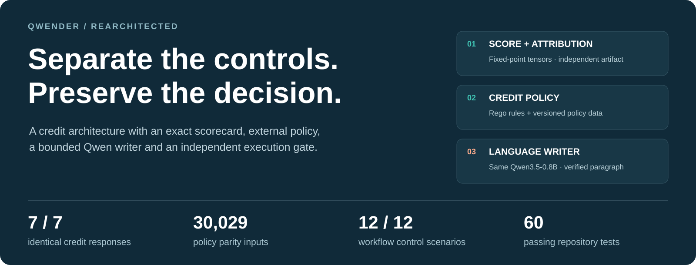
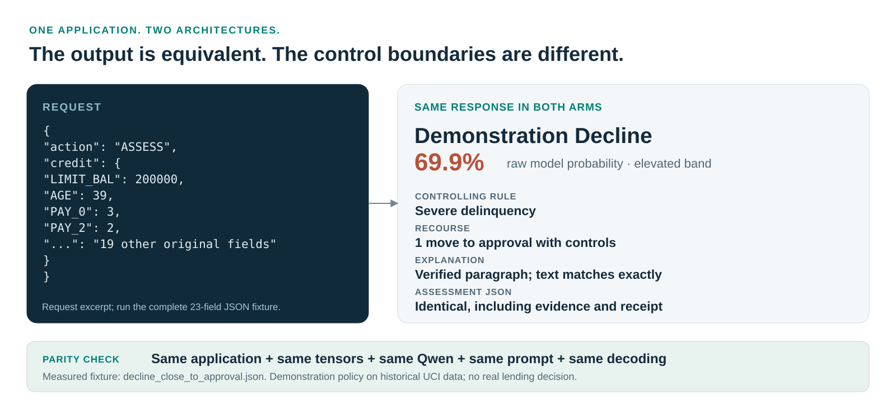
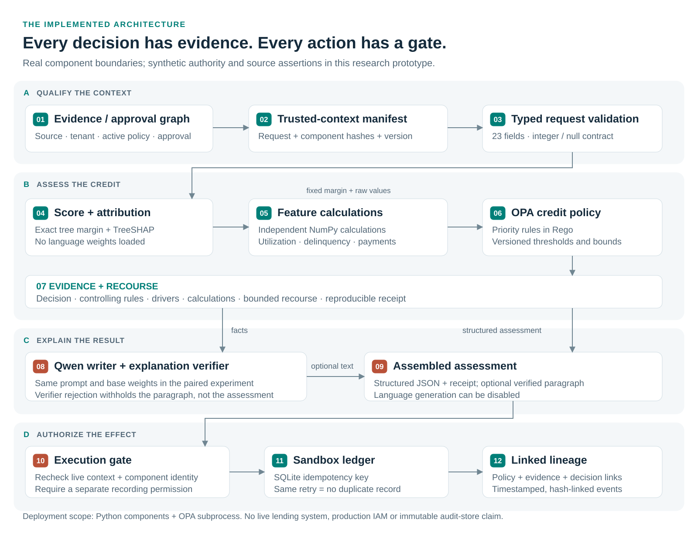
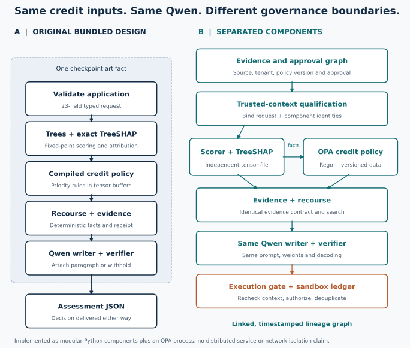

<p align="center">
  
</p>

<h1 align="center">Qwender, rearchitected</h1>

<p align="center"><strong>Exact credit decisions. Independent policy. Bounded language. Explicit permission to act.</strong></p>

<p align="center">
  
  
  
  
  <a href="LICENSE"></a>
</p>

<p align="center">
  <a href="docs/Credit_Architecture_Research_Paper.pdf">Research paper</a> ·
  <a href="docs/ARCHITECTURE.md">Architecture</a> ·
  <a href="docs/RESULTS.md">Measured results</a> ·
  <a href="docs/QUICKSTART.md">Run it</a> ·
  <a href="DOWNLOAD_MODELS.md">Model downloads</a>
</p>

A working credit-decision architecture that keeps the scorecard, credit policy,
language writer and permission to record a result under separate controls. It
reuses Qwenderwriter's exact scoring and attribution machinery, moves the credit
outcome rules into a real OPA process, and introduces explicit evidence-context
and execution boundaries.

**The result:** the seven tested credit assessments remain identical to the
bundled path, while policy changes, context qualification and sandbox recording
can be exercised independently. This repository contains the implementation,
weights for the native scorecard, paired responses, control scenarios and a
reproducible research report.

## One application. Two architectures. The same answer.

<p align="center">
  
</p>

The [complete request](fixtures/decline_close_to_approval.json) is assessed twice:
once through the original bundled class, once through the separated engine and
OPA. Both arms actually generate their own paragraph using the same Qwen base
weights, prompt and greedy decoding. There is no replayed or cached response.

The [paired record](results/decline_close_to_approval.json) preserves the input,
prompts, evidence, raw generations, verification status, timings and full JSON.

## Why separate the components?

A credit score, an applicable policy and permission to record a decision answer
different questions. They also change under different owners. This design makes
those boundaries explicit and connects their identities in a trusted-context
manifest.

| Enterprise question | Implemented answer | Proof to inspect |
| --- | --- | --- |
| Can policy change without replacing the scorer or loading Qwen? | Separate Rego and policy-data artifacts | [Policy-only release](results/policy_release.json) |
| Is this the approved policy and evidence context? | Policy-approval graph, source/tenant/freshness checks and component hashes | [Context controls](results/governance_cases.json) |
| Can the writer alter the arithmetic? | The deterministic service has no language parameters | [Detached engine](creditlab/engine.py), [component tests](tests/test_components.py) |
| Does assessment permission also authorize a write? | Separate assessment and recording permissions | [Execution gate](creditlab/governance.py) |
| What if context changes or the same request is retried? | Recheck before recording; idempotent SQLite ledger | [Workflow cases](results/governance_cases.json) |

The original already separates arithmetic from prose internally. Its strength is
one self-contained checkpoint identity. Our architectural difference is
independently governed artifacts plus a broader evidence-to-action workflow.

## Architecture: evidence to decision to authorized action

<p align="center">
  <a href="docs/assets/architecture.svg"></a>
</p>

1. **Qualify.** Check the declared source, tenant, evidence age, current policy,
   approval relationship and component identity; bind them to the request.
2. **Assess.** Validate 23 raw fields, score with exact tensors, calculate the
   policy features, ask OPA for the outcome, and compute evidence and recourse.
3. **Explain.** Optionally let Qwen write from the fixed fact sheet. A rejected
   paragraph is withheld; the structured assessment remains available.
4. **Authorize.** Before a sandbox record, recheck the live context, require a
   recording permission, deduplicate the write and link policy/evidence lineage.

**Implemented deployment:** modular Python components and an OPA subprocess.
The source, identity and approval assertions are research fixtures. The diagram
does not imply deployed microservices, a live bureau integration or production
identity infrastructure. [Read the component contracts and failure behavior →](docs/ARCHITECTURE.md)

<details>
<summary><strong>Compare the two release models</strong></summary>

<p align="center">
  
</p>

| Dimension | Original bundled path | This separated path |
| --- | --- | --- |
| Score and attribution | Compiled buffers in the Qwen checkpoint | Identical tensors in an independent artifact |
| Credit-outcome rules | Tensor policy in the checkpoint | Versioned Rego rules and policy data |
| Language | Writer attached to the checkpoint class | Same writer behind a callable interface |
| Evidence applicability | Raw input contract and compiled-state checks | Additional policy approval, freshness, source and tenant checks |
| Recording workflow | Outside the upstream assessment API | Explicit gate, SQLite ledger and linked lineage |
| Operational trade-off | Fewer artifacts to distribute | More boundaries to govern, test and operate |

Both designs can update policy without retraining the writer. The difference is
whether that policy release remains coupled to a language-model package.
</details>

## Evidence, with direct links

| Experiment | Measured result | Raw artifact |
| --- | --- | --- |
| Complete paired assessments | **7 / 7 identical JSON responses** | [All requests and responses](results/paired_responses.json) |
| External credit-policy parity | **30,000 rows + 29 selected boundary cases; zero differences** | [Field-by-field parity](results/policy_parity.json) |
| Workflow extensions | **12 / 12 expected control outcomes** | [Scenario log](results/governance_cases.json) |
| Original repository tests | **43 passed**, plus 6 subtests | [Original test log](results/logs/upstream-tests-final.log) |
| Added component/control tests | **17 passed** | [Added test log](results/logs/modular-tests.log) |
| Independent policy release | **Decline → manual review; same margin and scorer hash** | [Release experiment](results/policy_release.json) |
| Language verification | **3 / 5 paragraphs verified in each arm; 2 withheld** | [Run summary](results/summary.json) |

The comparison uses the **same unadapted Qwen3.5-0.8B** in both arms. It isolates
architecture; it does not reproduce the original author's LoRA-adapted writer or
its published verification rate. The two malformed requests never invoke Qwen.
The test badge reports this recorded run, not a hosted CI service.

[Full methodology, case outcomes and interpretation →](docs/RESULTS.md)

## Run a useful experiment

### 1 · Exercise the governance controls without model weights

```bash
git clone https://github.com/CodeDaim0n/qwender-rearchitected-repo.git
cd qwender-rearchitected-repo
python -m venv .venv
source .venv/bin/activate
pip install networkx pytest
PYTHONPATH=. python -m pytest tests/test_governance.py -q
```

This lightweight path tests authority, stale context, missing approval,
component changes and duplicate writes. It does not run the credit model.

### 2 · Rebuild and compare the complete credit process

```bash
pip install torch --index-url https://download.pytorch.org/whl/cpu
pip install -r requirements.txt
python scripts/reproduce.py
```

The rebuild fetches pinned upstream source and official Qwen weights, trains the
native scorecard, compiles its exact tensors and TreeSHAP, builds the bundled
checkpoint, extracts separate artifacts and runs both assessment paths. It also
runs policy parity and governance checks. No LoRA training is performed.

Already have the weights? Use `--base /absolute/path/to/qwen-snapshot`.
To restore the exact measured artifacts, follow [Model downloads](DOWNLOAD_MODELS.md).

### 3 · Run the separated workflow

After rebuilding or restoring the compiled artifacts and OPA binary:

```bash
python scripts/demo.py --record
python scripts/demo.py --request fixtures/decline_close_to_approval.json
python scripts/demo.py --checkpoint /absolute/path/original-layout-base-checkpoint
```

The first two commands need no Qwen weights. The third attaches the writer.
All recording is to a local sandbox. [Installation, artifact restoration and troubleshooting →](docs/QUICKSTART.md)

## Use the component API

```python
import json
from creditlab.workflow import CreditWorkflow
from creditlab.governance import valid_context

workflow = CreditWorkflow("models")
with open("fixtures/approval_with_controls.json") as stream:
    request = json.load(stream)

result = workflow.assess(
    request,
    context=valid_context(),  # Synthetic trusted context for this local experiment.
    case_id="example-001",
    record=True,
)
print(result["assessment"]["decision"]["outcome"])
print(result["assessment"]["model"]["probability_pct"])
print(result["record_status"])
```

```text
approval with controls
5.8%
RECORDED
```

[Inspect the complete recorded response](results/demo_response.json), including
its trusted-context manifest. `CreditWorkflow` can receive an optional writer
callable; its deterministic engine can be deployed without loading Qwen.

## Explore the repository

| Path | What it contains |
| --- | --- |
| [`creditlab/`](creditlab/) | Scoring facade, feature calculations, OPA adapter, writer, routing, governance and orchestration |
| [`policies/`](policies/) | Executable Rego credit policy |
| [`models/`](models/) | Native XGBoost weights, normalized trees, calibration, policy bundles and pinned identities |
| [`fixtures/`](fixtures/) | The seven original request fixtures |
| [`results/`](results/) | Paired responses, policy parity, workflow scenarios, lineage and build/test logs |
| [`scripts/`](scripts/) | Rebuild, extract, compare, demonstrate, restore models and regenerate documentation |
| [`tests/`](tests/) | Component integrity and governance regression tests |
| [`docs/`](docs/) | Research paper, architecture, results, quickstart and editable vector figures |

## Research scope and next steps

This is an implemented research prototype on historical UCI credit-card data and
a synthetic policy. It demonstrates tested response equivalence and explicit
control boundaries. It does not establish better underwriting, lower inference
cost, regulatory compliance or production readiness.

The remaining enterprise work is concrete: authenticate source and identity
assertions, introduce a signed approval registry, make audit lineage durable,
validate the portfolio over time and across groups, and test real service
isolation and operational failure modes. The existing verifier's semantic
limits and bounded, non-causal recourse remain. [Detailed boundaries →](docs/ARCHITECTURE.md#deployment-boundaries)

## Attribution and licence

Independent architecture experiment built on the exact credit machinery of
[Qwenderwriter](https://github.com/maximer-v/qwenderwriter), conceived and built by
**Javier Mancilla**, with pair review and paper co-authorship by **Tomas Tagliani**,
SquareOne Labs. The source is pinned to
`8d6015075d421eb1102db6dcc48a1caa62f84828`.

[Original paper](https://github.com/maximer-v/qwenderwriter/blob/main/paper/Qwenderwriter.pdf) ·
[Our research paper](docs/Credit_Architecture_Research_Paper.pdf) ·
[Third-party notices](THIRD_PARTY_NOTICES.md)

This derivative experiment preserves **CC BY-NC 4.0**. See [LICENSE](LICENSE).
Official Qwen base weights are Apache-2.0; UCI data is CC BY 4.0. Native XGBoost
weights are committed here. Larger Qwen and compiled attribution artifacts are
available through the [restore guide](DOWNLOAD_MODELS.md) and pinned rebuild;
ordinary Git blobs do not contain the full Qwen checkpoint.
