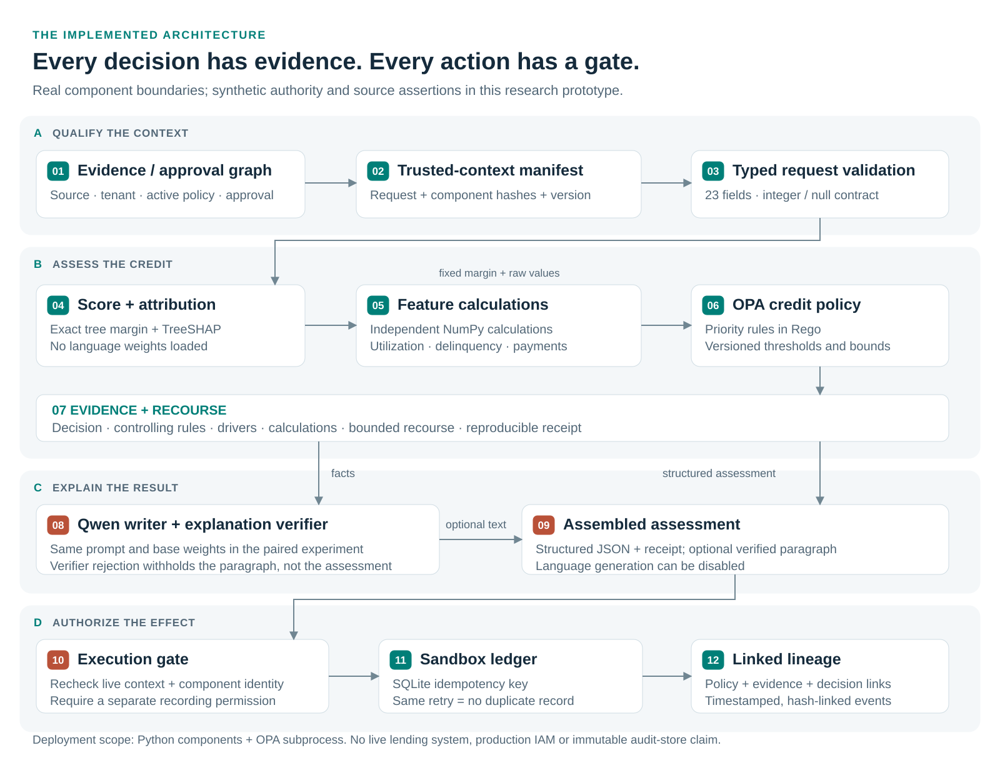

# Architecture and component contracts

[← Repository overview](../README.md) · [Measured results](RESULTS.md) · [Run it](QUICKSTART.md)

## The decision is one object; responsibility is not

The implementation separates three decisions: **what the scorecard predicts**,
**what credit policy requires**, and **whether this caller may record the
assessment now**. The language model writes about the first two. It does not
own their arithmetic or the third decision.



The numbers in the figure map to the implementation below. They describe logical
steps, not separately deployed network services.

## A. Qualify the context

| Step | Contract | Code and boundary |
| --- | --- | --- |
| 01 · Evidence and approval graph | Active policy must have the expected approval edge; declared source and tenant must be applicable | [`Governance.qualify`](../creditlab/governance.py); NetworkX graph and synthetic trusted registry |
| 02 · Trusted-context manifest | Bind request hash, component hashes, policy identity, context and registry version | [`CreditWorkflow.live_components`](../creditlab/workflow.py) and `Governance.qualify`; SHA-256 identities are not signatures |
| 03 · Typed input | Accept the 23-field integer/null contract; refuse malformed envelopes before scoring or generation | [`validate_raw_request`](../creditlab/routing.py); retained upstream validation |

The workflow qualifies context before entering the credit router. An explicitly
null value is accepted by the router and evaluated by policy as missing input.
A physically absent required key is refused by the router. Those are different
cases, and the original distinction is preserved.

## B. Assess the credit

| Step | Consumes → produces | Implementation |
| --- | --- | --- |
| 04 · Exact score and attribution | Integer feature vector → fixed-point margin and TreeSHAP contributions | [`DetachedEngine`](../creditlab/engine.py) and [`native_core.py`](../creditlab/native_core.py); no language parameters |
| 05 · Policy features | Raw values and missing mask → calculations and flags | [`features.calculate`](../creditlab/features.py); independent NumPy calculations |
| 06 · Credit outcome | Fixed margin, calculations, flags, thresholds → risk band, triggers, prioritized outcome and final reasons | [`OpaPolicy`](../creditlab/policy.py), [`credit.rego`](../policies/credit.rego), [`policy.json`](../models/policy.json) |
| 07 · Evidence and recourse | Verified deterministic fields → response facts, receipt and bounded improvement search | [`routing.py`](../creditlab/routing.py); same algorithms in the paired comparison |

The detached artifact contains scorer and attribution tensors. Credit-outcome
rules execute in an actual OPA subprocess. Policy thresholds, development bounds
and calibration data are a separate JSON artifact. Original margin grading and
its binary score threshold remain scorer metadata for exact response parity;
the demonstration credit outcome is selected by OPA.

The core is extracted mechanically from pinned upstream Python classes. The
language superclass and constructor are removed; score/attribution arithmetic
and verification methods are retained. The [extraction script](../scripts/extract_native_core.py)
and [component test](../tests/test_components.py) make the boundary inspectable.

## C. Explain the result

The writer is an optional callable with the interface `writer(system, user) -> str`.
It receives a fact sheet, then the retained explanation verifier checks its output.

| Situation | Current behavior |
| --- | --- |
| No writer configured | Structured assessment returns with `NOT_GENERATED` |
| Paragraph passes the verifier | Paragraph is attached with `VERIFIED` |
| Paragraph fails the verifier | Paragraph is withheld; deterministic assessment is delivered |
| Writer throws an exception | The exception propagates; automatic outage fallback is not implemented |

Verifier rejection and writer availability are therefore separate concerns.
The experiment keeps the upstream verifier unchanged to avoid confounding
architecture with text quality. Its checks do not establish full semantic
faithfulness, helpfulness or lawful customer communication.

## D. Authorize the effect

Assessment permission does not imply recording permission. When `record=True`,
the application requalifies live context and compares its binding with the
manifest from before assessment. It then checks recording permission and
assessment validity before attempting a SQLite write.

| Condition at recording | Result |
| --- | --- |
| Same context, authorized caller, valid assessment, new case ID | `RECORDED` |
| Same case ID and exactly the same stored assessment | `ALREADY_RECORDED` |
| Same case ID with a different assessment | `IDEMPOTENCY_CONFLICT` |
| Request or registry binding changed | `CONTEXT_CHANGED_BEFORE_WRITE` |
| Live component identities changed | `COMPONENT_CHANGED` |
| Caller may assess but may not record | `WRITE_NOT_AUTHORIZED` |

Lineage connects the recorded decision to its policy and evidence. Events store
timestamps, assessment/context hashes and the previous-event hash. The default
ledger is in memory; `CreditWorkflow(..., ledger="decisions.sqlite")` selects a
persistent SQLite ledger. The event list and graph remain in memory in either
case; they are not an immutable audit platform.

## Artifact ownership and release boundaries

| Artifact | Purpose | What a controlled change needs |
| --- | --- | --- |
| `scorer-attribution.safetensors` | Exact scoring and attribution | Compilation/parity evidence and approved model identity |
| `policy.json` + `credit.rego` | Credit policy data and executable rules | Policy approval, version/identity update and integration checks |
| Qwen base checkpoint | Paragraph generation | Writer validation and generation settings |
| Trusted registry/context | Policy applicability and authority | Authenticated source integration in a production implementation |
| Workflow and gate code | Compose outputs and authorize effects | Control regression checks and operational change review |

The [policy release experiment](../results/policy_release.json) intentionally
changes a credit outcome without changing the score or loading Qwen. It uses a
synthetic local approval step. It does not demonstrate a bank approval workflow.

## Fail closed where the code has a boundary

Changed compiled buffers fail the score receipt check. Changed Rego or policy
data fail the approved hash checks. Missing OPA execution raises rather than
silently substituting a Python credit outcome. These are explicit exceptions,
not a fully specified HTTP error protocol.

See the [tamper and availability tests](../tests/test_components.py) and
[workflow cases](../results/governance_cases.json). No failure result is counted
as evidence that the upstream assessment API would perform an unsafe external
write; it has no corresponding write workflow.

## Deployment boundaries

| Demonstrated here | Required before a production credit deployment |
| --- | --- |
| Modular Python components and OPA subprocess | Service isolation, authenticated transport, availability and load testing |
| Declared source, tenant, evidence age and principal | Real identity, bureau/source integrations and trusted timestamps |
| Synthetic approval relationships | Independently authenticated, versioned approval registry |
| SHA-256 component/context binding | Signed releases, key management and institutional trust anchors |
| SQLite recording and in-memory lineage | Durable audit/event infrastructure, retention and access controls |
| Historical benchmark and demonstration policy | Portfolio, temporal, calibration, fairness and policy validation |

The original deterministic arithmetic, bounded recourse and verifier limitations
remain. Independent artifacts reduce lifecycle coupling; they introduce more
interfaces and identities to govern. They are not evidence of lower cost,
better underwriting or regulatory compliance.

## Regenerate the diagrams

All figures are native SVG, with PNG companions for document generation.

```bash
pip install -r requirements-docs.txt
python scripts/design_repository_assets.py --render
python scripts/make_paper.py
```

The vector source, evidence used for the example and generator are committed.
The compact comparison remains at `docs/architecture_comparison.svg` so the
research report and its existing links retain a stable target.
